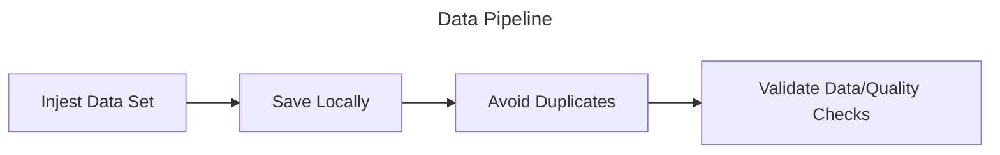

# Senior Data Engineer Screening

## Instructions

### WPRDC Data Pipeline Exercise

Pick **one** dataset from the list below. Build a small, reproducible pipeline that ingests it from the [WPRDC](https://www.wprdc.org/en) CKAN API, produces a clean analytical table, and tells us something useful about the data. Your completed script and markdown document should be available in a public GitHub or GitLab repository.

**Requirements**

1. **Ingest** the data programmatically (CKAN API or resource URL). No manual downloads.

2. **Land raw data unchanged**, then transform into a cleaned/modeled layer. Use any local stack you like (Python, SQL, DuckDB, SQLite, Postgres via Docker, dbt, etc). No cloud accounts required.

3. **Make it re-runnable.** Running it twice must not duplicate or corrupt data. Explain how you’d handle the dataset being updated.

4. **Add data quality checks** that would actually fail on bad data. Include at least one check you wrote because of something you found in this dataset.

5. **Produce one output table** that could be used to answer a question you chose (state the question).

6. **Write a README.md** covering decision you made in the process: the three most important design decisions and the alternatives you rejected, what surprised you in the data, what you’d do differently at 100x scale or with daily refreshes, and what you didn’t do and why.

7. **AI disclosure:** AI tools are allowed. Tell us which you used and for what purpose. We will ask you to walk through your code live should you progress to an interview round.

**Data Sets**

- Allegheny County Property Sale Transactions

- Allegheny County Weights and Measures Inspections

- Allegheny County Air Quality

- Allegheny County Jail Census

## Proposed Solutions

### Option 1 - Overkill

Orchestraton - Apache Airflow
Blob Storage - Minio
Transactional - Postgres
Analytical - DuckDB
Quality - dbt

Way too much for this request. Requires Docker and other packages to be installed.

### Option 2 - Too simple

Just Python and DuckDB. But this is too simple and would need a bit more for data quality and validation.

### Option 3 - The winner

Take the simplicity of option 2, but add dbt on top. This gives us everything we need to complete the request.

