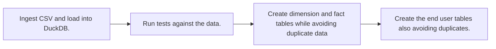

# Senior Data Engineer Screening

## Instructions to run

### Requirements

Python and uv are the only things that need to be installed.

- Python: https://www.python.org/downloads/
- uv: https://docs.astral.sh/uv/guides/install-python/
- DuckDB CLI (if you want to tinker with the database): https://duckdb.org/install/?platform=linux&environment=cli

### To Run

Before running the program, create a virtual environment.

```bash
uv venv
source .venv/bin/activate
uv pip install -r requirements.txt
```

Once activated, run the following `uv` command to run the application. This will ingest the data, build the bronze, silver, and gold layers, and run tests.

```bash
uv run main.py
```

Connect to the DuckDB database if you want to view the tables. Requires DuckDB be installed. Note: this database won't exist until after the first run.

```bash
duckdb ./air_quality_data/air_quality.duckdb
```

## The Assignment

### WPRDC Data Pipeline Exercise

Pick **one** dataset from the list below. Build a small, reproducible pipeline that ingests it from the [WPRDC](https://www.wprdc.org/en) CKAN API, produces a clean analytical table, and tells us something useful about the data. Your completed script and markdown document should be available in a public GitHub or GitLab repository.

**Requirements**

1. **Ingest** the data programmatically (CKAN API or resource URL). No manual downloads.
2. **Land raw data unchanged**, then transform into a cleaned/modeled layer. Use any local stack you like (Python, SQL, DuckDB, SQLite, Postgres via Docker, dbt, etc). No cloud accounts required.
3. **Make it re-runnable.** Running it twice must not duplicate or corrupt data. Explain how you’d handle the dataset being updated.
4. **Add data quality checks** that would actually fail on bad data. Include at least one check you wrote because of something you found in this dataset.
5. **Produce one output table** that could be used to answer a question you chose (state the question).
6. **Write a README.md** covering decision you made in the process: the three most important design decisions and the alternatives you rejected, what surprised you in the data, what you’d do differently at 100x scale or with daily refreshes, and what you didn’t do and why.
7. **AI disclosure:** AI tools are allowed. Tell us which you used and for what purpose. We will ask you to walk through your code live should you progress to an interview round.

**Data Sets**

- Allegheny County Property Sale Transactions
- Allegheny County Weights and Measures Inspections
- Allegheny County Air Quality
- Allegheny County Jail Census

## Proposed Solutions

### Tech stack

#### Option 1 - Overkill

Orchestraton - Apache Airflow

Blob Storage - Minio

Transactional - Postgres

Analytical - DuckDB

Modeling and Quality - dbt

Way too much for this request. Has a lot of requirements and a lot could go wrong.

#### Option 2 - A little simpler but still too much

Use Python, DuckDB, and dbt. While dbt is very useful and could help out here, it's still another requirement and added complexity.

#### Option 3 - The winner

Just Python and DuckDB. Python because of the speed and use in the data world. DuckDB because it's not complicated to install, plays nicely with Python, it's crazy fast, and I'll always take an excuse to use it.

### Workflow



## Details of the assignment

For this assignment, I decided to use the Daily AQI Data dataset https://data.wprdc.org/dataset/allegheny-county-air-quality/resource/4ab1e23f-3262-4bd3-adbf-f72f0119108b. I chose AQI considering the region's history with pollution and also I'm a member of the "sensitive groups". I went with the daily dataset instead of the hourly for simplicity and time but I feel like the hourly details would have been more interesting. I also wasn't sure if the index_value per site and parameter are an average or the max for the daily dataset so I had to make assumptions.

### Answers to the requirements with questions

> 3. **Make it re-runnable.** Running it twice must not duplicate or corrupt data. Explain how you’d handle the dataset being updated.

Duplicates are handled via DuckDB's `ON CONFLICT` clause with the insert. This will disregard any duplicates.

One thing that is currently not handled is updates to the raw data. To handle that, I could add in logic to do one of the following:
- Allow multiple entries for the same date, site, and parameter. If the index_value, or another value, changes, insert that with a way to track it like a "latest" flag or timestamp. Then only use the latest data. The problem with this is either the downstream tables would need to be updated or truncated and re-inserted assuming it's not a view/dynamic table/etc..
- Update the row in the fact table. This is probably the easiest but then you lose the insights of seeing what changed over time. 

Which answer would depend on the end user and their requirements. 

> 4. **Add data quality checks** that would actually fail on bad data. Include at least one check you wrote because of something you found in this dataset.

This dataset was very clean and I didn't have to do much here. This makes sense since this dataset is most likely a rollup of the hourly dataset. But there were a few things.

The one issue I did have was with the line endings in the CSV. This issue was fixed by disabling strict mode for DuckDB's CSV import. 

The dataset included an ID column (_id), but there were gaps in the sequence. I added a "warning" test to print a warning if there are gaps found in the sequence of the ID column. This would be good to have in case someone intended to use the ID column and acted under the assumption there are no gaps.

> 5. **Produce one output table** that could be used to answer a question you chose (state the question).

My original question was going to be to pull the data for any records where the health event contained the word "asthma". But after taking a look at the health events, I realized that only one contained the word "asthma".

I then thought about analyzing the data for the records with index_value above 100. But that was a bit sporadic and nothing too interesting from that.

So I then turned to my friend Claude to come up with some ideas around interesting analysis. It came up with a few ideas but the one that grabbed me was pollution episodes for anything above X index_values and affected N sites. 

The question I am asking is "When were there multiple sites with air quality over 100 and how long did it last".

Claude produced an initial query for me. After some edits from both myself and Claude, we ended up with this final query:

```sql
WITH county_day AS (
    SELECT
        dd.date,
        max(fdaq.index_value) AS peak_value,
        arg_max(dp.parameter, fdaq.index_value) AS peak_parameter,
        count(DISTINCT site_id) FILTER (WHERE index_value > 100) AS sites_over
    FROM fact_daily_air_quality fdaq
    INNER JOIN dim_date dd
        ON fdaq.date_id = dd.id
    INNER JOIN dim_parameter dp
        ON fdaq.parameter_id = dp.id
    GROUP BY dd.date
    HAVING sites_over > 2
),
grouped AS (
    SELECT
        date,
        peak_value,
        peak_parameter,
        sites_over,
        date - (row_number() OVER (ORDER BY date))::INT * INTERVAL 1 DAY AS grp
    FROM county_day
)
SELECT
    min(date) AS start_date,
    max(date) AS end_date,
    count(1) AS num_days,
    max(peak_value) AS max_peak,
    arg_max(peak_parameter, peak_value) AS peak_parameter,
    max(sites_over) AS max_sites
FROM grouped
GROUP BY grp;
```

Which gives this output:

**Pollution Episodes**

| start_date | end_date | num_days | max_peak | peak_parameter | max_sites |
|-----|-----|-----|-----|-----|-----|
| 2017-12-03 | 2017-12-03 | 1 | 163.0 | PM25T | 3 |
| 2020-11-08 | 2020-11-08 | 1 | 118.0 | PM25 | 3 |
| 2021-07-05 | 2021-07-05 | 1 | 153.0 | PM25T | 3 |
| 2021-07-20 | 2021-07-20 | 1 | 129.0 | PM25_640 | 4 |
| 2023-06-06 | 2023-06-06 | 1 | 115.0 | PM25T | 3 |
| 2023-06-28 | 2023-06-30 | 3 | 212.0 | PM25_640 | 8 |
| 2023-07-17 | 2023-07-17 | 1 | 132.0 | PM25_640 | 5 |
| 2026-07-16 | 2026-07-18 | 3 | 253.0 | PM25_640 | 9 |

> 6. **Write a README.md** covering decision you made in the process: the three most important design decisions and the alternatives you rejected, what surprised you in the data, what you’d do differently at 100x scale or with daily refreshes, and what you didn’t do and why.

Here are the 3 most important design decisions I kept in mind while working on this project

#### Tech stack

**What I chose:** I approached this task like I do with any project I work on and that's to follow the KISS principle. This is why I went with just Python and DuckDB because I felt like this was all that was needed to accomplish the task.
**What I rejected:** Using other tools like PySpark, dbt, Postgres, etc. I rejected the tools like PySpark and dbt as I wanted to keep the modeling simple and it did not require much power. I didn't use other data management tools since DuckDB has an official package and works extremely fast with its in-memory capabilities.
**Tradeoffs:** I know that using tools is very common in data engineering and using them would show additional skills. But that would go against me following the KISS principle and would have added additional time to this project.

#### Data Ingestion

**What I chose:** A single call to download the CSV for the daily air quality dataset. This made it quick to code and quick to pull since the dataset was small.
**What I rejected:** Partitioned or paged pulls. I decided to not complicate the call by using the CKAN API to pull the data by date or X amount of records at a time. The current dataset itself was small and doing this would have added more code and more calls.
**Tradeoffs:** The major trade off was there were inconsistent line endings that broke DuckDB's CSV import. I had to disable strict mode in order to load the data into DuckDB from the CSV. While this worked for this example, it's not a good practice for something in a production environment. This would also not be usable for a large dataset as the single call could possibly be a large size and rejected by the API, a firewall, or anything else in-between.

#### Data durability

**What I chose:** Use primary keys and `ON CONFLICT DO NOTHING` for loading the datasets. This allowed me to use the power of DuckDB for handling data quality and allowed the script to be executed multiple times without corrupting the data.
**What I rejected:** Handling data upserts. If the ingested dataset updated existing records, those would be ignored.
**Tradeoffs:** Data quality suffers here. Upserts are silently ignored and that could cause problems. Unless we know for certain that the raw data is only inserted and never updated, this would cause problems.

#### Data findings

One thing that surprised me about the data was how few pollution episodes there were. There are definitely some bad days, but nothing extended. The last entry in July of 2026 doesn't surprise me since that was a large forest fire northwest of the region. 

#### Running at scale

To run this at a greater scale and/or more frequently is when I would start to look at adding additional tools. Something like PySpark to distribute the workload (if needed), Airflow to orchestrate the work, dbt to create the models and do testing, Git tooling (GitLab, GitHub, etc.) to drive things like version control and CI/CD, or many of the other tools out there to assist. The sky is the limit when it comes to tooling, but tooling should not be the first thought. Understanding the customer requirements and the goals should be the first step, then you can begin architecting the solution and add in tools as necessary. It's also unclear if the stack is hosted with a cloud provider or self-hosted. Knowing how much work goes into maintaining the environment would drive certain decisions.

#### What I didn't do and why

1. **Fixing strict-mode for CSV ingestion:** This came down to time. Using a different approach to download the data (e.g. use CKAN API) would have allowed me to have more control over the final format of the raw data and would have helped avoid the line ending issues. But doing so would require me to spend more time coding that piece of the pipeline. And the goal for this is to create an MVP.

2. **AQI dimension** This would have reduced the number of dimension tables and pushed denormalizing the tables. But that would have taken me away from the code to learn about AQI and how the EPA groups that information. This would also assume that data hasn't changed since the beginning of this dataset. This would be something I would take the time to learn in a real world situation.

3. **Multiple raw data files** For the sake of time and simplicity, I overwrite the downloaded CSV. In the real world, I would architect a way to store the raw data files to retain the data. I would have also developed a way to avoid overwriting those files unless the data itself changed. 

## Where I had Claude help

### Tell me my first plan was way too much

I put in the requirements and my original plan to get an opinion. And as I thought, it came back saying it was too much. But just Python was not enough. So it gave a few options and I landed on Python with DuckDB.

### Guidance on Ingesting the data

There were a few ways to do this floating around in my head. Download the CSV via requests, use ckanapi to download the whole dataset, or use ckanapi to get the oldest date and then inject the dataset by day so it can be partitioned and to keep the requests small.

I threw these ideas into Claude and it came back with a fourth (why didn't I think of that!) option. Paging the results. It would prevent one large request while also preventing too many small requests.

However, for this I ultimately ended up just going with downloading the CSV. The dataset I'm using is the daily air quality and it's not very large.

### Error reading CSV into DuckDB

Needed some help with this. Seems like the line endings were causing some issues. Quick and dirty fix was to disable strict mode. Should go back and fix that but it at least let me keep moving.

### Getting the first dimension table down

Was struggling to decide the best way to create that first table. I know SQL very well but wanted to see if there was a more "Python" way of doing this with DuckDB. While it seems like there is, there's nothing wrong with using SQL and Claude even suggested that.

### Mentioned AQI dim

A good idea Claude mention was building an AQI dim instead of separate tables for each of those. Would have to verify the description, health_advisory, and health_effects fields are standard within the EPA or whatever organization provides these details.

It did make me realize I should do a data test to make sure the values and the description match since that's pretty standard.

### Brainstorm some creative output tables

I was originally going to play around with the data where there was a health effect that specifically mentioned asthma, but that wasn't much data. I then thought about playing around with the data where the index_value was above 100. More data, but not really that interesting. 

I had Claude throw out some ideas and one it suggested was pollution episodes. This would be anything that was over X index_value and affected N sites. Decided to go with 100 index_value and 3 or more sites. I did have it help me with the query (explained above).