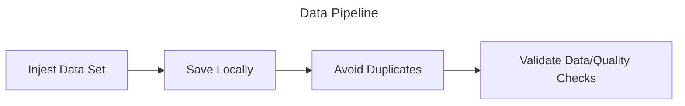

# Senior Data Engineer Screening

## Instructions

### Requirements

Python and uv are the only things that need to be installed.

- Python: https://www.python.org/downloads/
- uv: https://docs.astral.sh/uv/guides/install-python/
- DuckDB CLI (if you want to tinker with the database): https://duckdb.org/install/?platform=linux&environment=cli

### To Run

Before running the program, create a virtual environment.

```bash
uv env
source .venv/bin/activate
uv pip install -r requirements.txt
```

Once activated, run the following `uv` command to run the application. This will injest the data, build the bronze, silver, and gold layers, and run tests.

```bash
uv run main.py
```

Connect to the DuckDB database if you want to view the tables. Note: this database won't exist until after the first run.

```bash
duckdb ./air_quality_data/air_quality.duckdb
```

## The Assignment

### WPRDC Data Pipeline Exercise

Pick **one** dataset from the list below. Build a small, reproducible pipeline that ingests it from the [WPRDC](https://www.wprdc.org/en) CKAN API, produces a clean analytical table, and tells us something useful about the data. Your completed script and markdown document should be available in a public GitHub or GitLab repository.

**Requirements**

1. **Ingest** the data programmatically (CKAN API or resource URL). No manual downloads.
2. **Land raw data unchanged**, then transform into a cleaned/modeled layer. Use any local stack you like (Python, SQL, DuckDB, SQLite, Postgres via Docker, dbt, etc). No cloud accounts required.
3. **Make it re-runnable.** Running it twice must not duplicate or corrupt data. Explain how you’d handle the dataset being updated.
4. **Add data quality checks** that would actually fail on bad data. Include at least one check you wrote because of something you found in this dataset.
5. **Produce one output table** that could be used to answer a question you chose (state the question).
6. **Write a README.md** covering decision you made in the process: the three most important design decisions and the alternatives you rejected, what surprised you in the data, what you’d do differently at 100x scale or with daily refreshes, and what you didn’t do and why.
7. **AI disclosure:** AI tools are allowed. Tell us which you used and for what purpose. We will ask you to walk through your code live should you progress to an interview round.

**Data Sets**

- Allegheny County Property Sale Transactions
- Allegheny County Weights and Measures Inspections
- Allegheny County Air Quality
- Allegheny County Jail Census

## Proposed Solutions

### Option 1 - Overkill

Orchestraton - Apache Airflow
Blob Storage - Minio
Transactional - Postgres
Analytical - DuckDB
Quality - dbt

Way too much for this request. Requires Docker and other packages to be installed.

### Option 2 - Too simple

Just Python and DuckDB. But this is too simple and would need a bit more for data quality and validation.

### Option 3 - The winner

Take the simplicity of option 2, but add dbt on top. This gives us everything we need to complete the request.



## Where I had AI help

### Tell me my first plan was way too much

I put in the reqiurements and my original plan to get an opinion. And as I thought, it came back saying it was too much. But just Python was not enough. So it gave a few options and I landed on Python with DuckDB dbt.

### Guidance on Injesting the data

There were a few ways to do this floating around in my head. Download the CSV via requests, use ckanapi to download the whole dataset, or use ckanapi to get the oldest date and then inject the dataset by day so it can be partitioned and to keep the requests small.

I threw these ideas into Claude and it came back with a forth (why didn't I think of that!) option. Paging the results. It would prevent one large request while also preventing too many small requests.

However, for this I ultimately ended up just going with downloading the CSV. The dataset I'm using is the daily air quality and it's not very large.

### Error reading CSV into DuckDB

Needed some help with this. Seems like the line endings were causing some issues. Quick and dirty fix was to disable strict mode. Should go back and fix that but it at least let me keep moving.

### Getting the first dimension table down

Was stuggling to decide the best way to create that first table. I know SQL very well but wanted to see if there was a more "Python" way of doing this with DuckDB. While it seems like there is, there's nothing wrong with using SQL and Claude even suggested that.

### Mentioned AQI dim

A good idea Claude mention was building an AQI dim instead of separate tables for each of those. Would have to verify the description, health_advisory, and health_effects fields are standard within the EPA or whatever organization provides these details.

It did make me realize I should do a data test to make sure the values and the description match since that's pretty standard.


## Random stuff

Using duckdb and just running a select * from csv is throwing error. But once it loads once, then it's fine.

SELECT *
         FROM read_csv('air_quality_data/daily_air_quality.csv');


         SELECT *
         FROM read_csv('air_quality_data/daily_air_quality.csv',delim=',',
         columns = {
             '_id': 'INT',
             'date': 'DATE',
             'site': 'VARCHAR',
             'parameter': 'VARCHAR',
             'index_value': 'FLOAT',
             'description': 'VARCHAR',
             'health_advisory': 'VARCHAR',
             'health_effects': 'VARCHAR'},quote='"',escape='"',strict_mode=false,header=true);